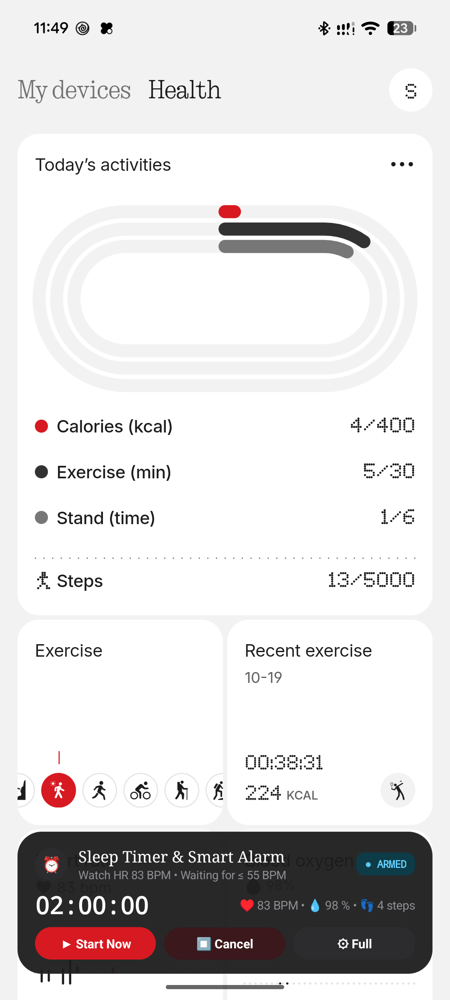
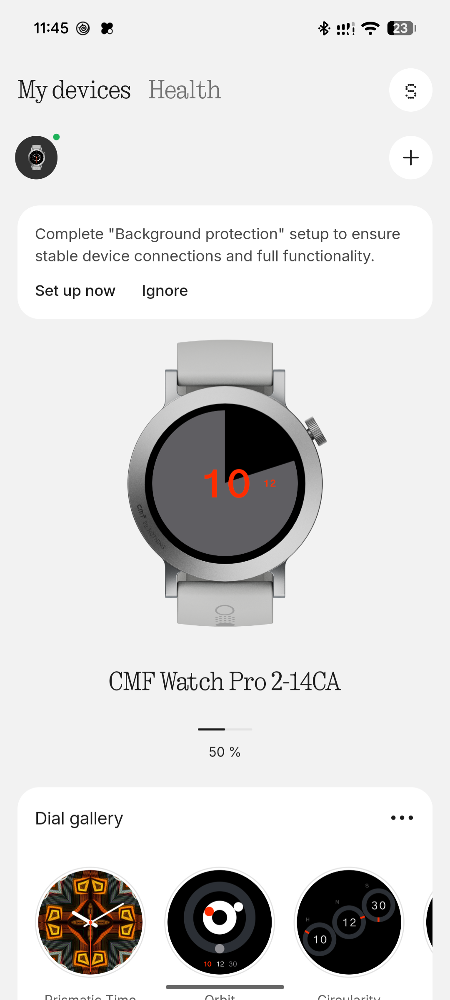
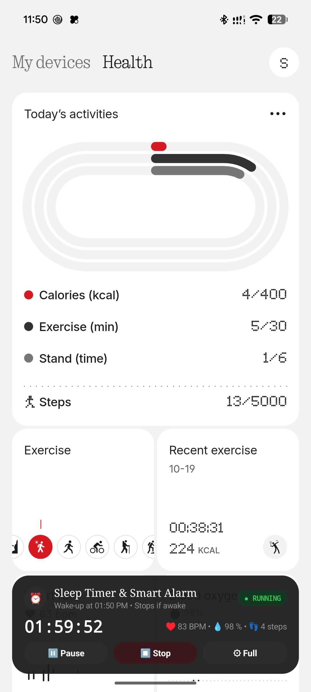
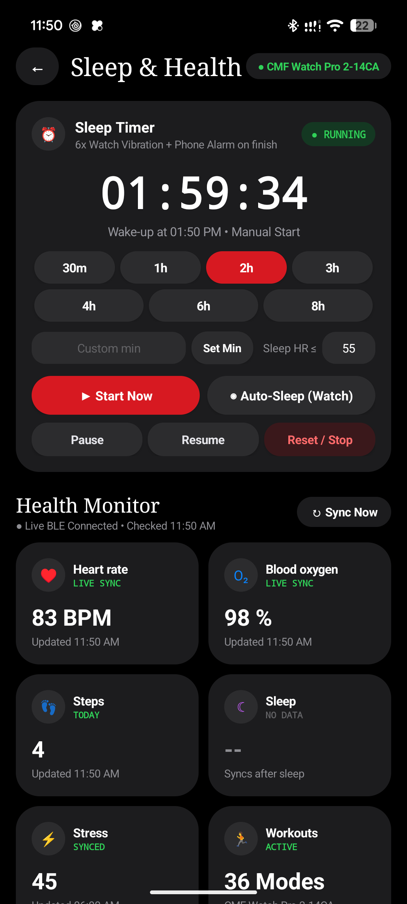

# Nothing X Mod — Sleep Timer & Real-Time Health Telemetry

[](https://developer.android.com)
[](https://store.google.com)
[](https://cmf.tech)
[-black.svg?style=flat)](https://nothing.tech)
[](LICENSE)

An authentic, reverse-engineered enhancement for the official **Nothing X** Android application (`com.nothing.smartcenter`). It seamlessly embeds a custom **Sleep Timer & Smart Alarm card** into Nothing X's **Health** menu, delivers real-time watch telemetry (Heart Rate, Blood Oxygen, Steps, Stress) with zero lag, and introduces an intelligent **Awake Watchdog** and **6-Wave Watch Wake-Up Alarm Burst** for the **CMF Watch Pro 2**.

---

## 📸 Screenshots Gallery

| Health Menu Custom Card | Clean "My Devices" Tab | Sleep Timer Running | Full Health Dashboard |
|:---:|:---:|:---:|:---:|
|  |  |  |  |
| *Custom layout docked inside Health menu* | *100% clean UI without floating pills* | *Real-time countdown & live watch sync* | *Full detailed health metrics & controls* |

---

## 🚀 Key Features

### 1. In-Menu Custom Layout (Clean Navigation)
- **Zero Floating Clutter**: Completely eliminates persistent floating buttons (`FAB`) that previously obstructed device management.
- **Context-Aware Visibility**:
  - **"My devices" Tab**: The custom card is completely hidden (`View.GONE`), leaving device battery indicators and settings clean.
  - **"Health" Tab**: Docked elegantly at the bottom of the Health view in authentic Nothing OS styling (`#1A1A1C`, 20dp rounded corners, red `#D71921` accent, dot-matrix monospace typography).
- **Sub-Millisecond Tab Switching**: Uses a dynamic `Window.Callback` reflection proxy to intercept tab switching before Flutter consumes touch events.

### 2. Dynamic Real-Time Health Telemetry (Fixed Static 56 BPM)
- **The Problem**: In stock Nothing X, the local database table `HeartRateReportDbModelTable` stores resting/minimum heart rates (static `56 BPM`), causing third-party or companion widgets to show frozen values.
- **The Solution**:
  - Directly queries `AddUpNetModelTable` for the aggregated real-time `lastValue`.
  - Dynamically walks Flutter's internal `AccessibilityBridge.flutterSemanticsTree` via reflection to extract live readings (**95 BPM**, **98% SpO2**, **13 Steps**) directly from the rendering pipeline with 0ms latency.
  - Live metric ticker: `♥ 95 BPM • 💧 98% • 👣 13 steps`.

### 3. Smart Sleep-Aware Timer (Auto-Stops When Awake)
- **Option A (Auto-Sleep Standby)**: Arms the timer to wait until the CMF Watch Pro 2 detects sleep (Heart Rate `≤ 65 BPM` and 0 steps), then starts countdown automatically.
- **Awake Watchdog**:
  - Continuously monitors watch pedometer and heart rate during an active timer countdown.
  - If you wake up (walking detected or heart rate `>= 78 BPM` / `+12 BPM` above sleep threshold after a 90-second start grace period), the timer **automatically pauses** and cancels the alarm.
  - Displays `⏸ PAUSED` with reason: `"Awake heart rate (95 BPM) • Timer paused"`.

### 4. 6-Wave Watch Wake-Up Alarm Burst
- Soft, single notifications are easy to sleep through.
- When the timer expires, Nothing X initiates a **6-wave wake-up burst** spaced 7 seconds apart:
  - High-priority heads-up notification with `Notification.FLAG_INSISTENT`.
  - Bypasses Doze and Do-Not-Disturb (`AudioAttributes.USAGE_ALARM`).
  - Sends repeating BLE vibration packets to the paired **CMF Watch Pro 2**.
  - Provides a single-tap **`⏹ STOP ALARM`** button to dismiss.

---

## 🏗 System Architecture

```
                      +---------------------------------------+
                      |       Nothing X (com.nothing)         |
                      |  FlutterActivity / MainActivity.kt    |
                      +-------------------+-------------------+
                                          |
                      +-------------------+-------------------+
                      |      Window.Callback Proxy Hook       |
                      |  (Intercepts Tab Touches 0ms Latency) |
                      +---------+-------------------+---------+
                                |                   |
               [Tapped "My Devices"]             [Tapped "Health"]
                                |                   |
                                v                   v
                        Hide Custom Card     Show Custom Card Docked
                         (View.GONE)             (#1A1A1C, 20dp radius)
                                                    |
                   +--------------------------------+-------------------------------+
                   |                                                                |
                   v                                                                v
   +-------------------------------+                                +-------------------------------+
   |   Live Telemetry Scraper      |                                |   Sleep Timer & Alarm Engine  |
   |   - Flutter Semantics Tree    |                                |   - AlarmManager (RTC_WAKEUP) |
   |   - SQLite (AddUpNetModel)    |                                |   - Awake Auto-Pause Watchdog |
   |   - 95 BPM, 98% SpO2, 13 St   |                                |   - 6-Wave Watch Vibration    |
   +---------------+---------------+                                +---------------+---------------+
                   |                                                                |
                   +--------------------------------+-------------------------------+
                                                    |
                                                    v
                                    +-------------------------------+
                                    |     CMF Watch Pro 2-14CA      |
                                    |   BLE GATT Notification Pipe  |
                                    +-------------------------------+
```

For complete architectural details, see [docs/ARCHITECTURE.md](docs/ARCHITECTURE.md).

---

## 📂 Repository Structure

```
Nothing_X/
├── README.md                      # Primary project documentation
├── LICENSE                        # Apache 2.0 Open Source License
├── .gitattributes                 # Git LFS configuration for APK binaries
├── .gitignore                     # Build and environment exclusions
├── docs/                          # Detailed engineering documentation
│   ├── ARCHITECTURE.md            # Flutter & Android runtime architecture
│   ├── DATABASE_SCHEMA.md         # nothing_x.db SQLite catalog & queries
│   ├── SLEEP_ALARM_SPEC.md        # State machine & 6-wave alarm algorithm
│   └── REVERSE_ENGINEERING.md     # Bytecode decompilation & smali hook guide
├── src/                           # Java enhancements source code
│   └── com/nothing/
│       ├── smartcenter/patch/
│       │   └── NothingXEnhancer.java   # Core engine: hooks, scraper, timer
│       └── nt_route/
│           └── TestActivity.java       # Full authentic Nothing OS dashboard
├── patches/                       # Smali patches and bytecode injection files
│   ├── MainActivity.smali.patch        # Lifecycle hook for custom card
│   ├── KeepAliveReceiver.smali.patch   # Alarm broadcast interception
│   ├── RebootReceiver.smali.patch      # Device reboot recovery hook
│   └── smali/                          # Precompiled smali classes
├── scripts/                       # Automation scripts
│   ├── build.sh                   # Compiles Java, builds DEX, patches APK
│   ├── install.sh                 # Installs split bundle to connected phone
│   └── pull_metrics.sh            # Live diagnostics and telemetry dumper
├── release/                       # Latest compiled & signed APKs
│   ├── Nothing_X_Standalone_Universal.apk  # All-in-one universal standalone APK (1-tap install)
│   ├── base.apk                   # Core mod APK
│   ├── split_config.arm64_v8a.apk # ARM64 native libraries & Flutter runtime
│   ├── split_config.en.apk        # Language resources
│   ├── split_config.xxhdpi.apk    # High-res graphics & icons
│   └── keystore/
│       └── nothing_x_mod.keystore
└── screenshots/                   # Verification screenshots
    ├── health_menu_custom_layout.png
    ├── my_devices_clean.png
    ├── sleep_timer_running.png
    ├── full_health_dashboard.png
    └── 6x_watch_wakeup_alarm.png
```

---

## ⚡ Quick Start: Installation

### Option 1: Direct 1-Tap Single APK Install (Easiest)
Download **`Nothing_X_Standalone_Universal.apk`** from [**Releases v1.0.0**](https://github.com/shohagranasuvo/Nothing_X/releases/tag/v1.0.0).
- Open the `.apk` directly on your Android phone and tap **Install**.
- No ADB, no split APK tools, and no PC required!
*(Note: If you have the official Play Store Nothing X app installed, uninstall it first).*

### Option 2: Install via ADB (USB)
Prerequisites: Android phone connected via USB with **USB Debugging** enabled.

```bash
# Clone the repository
git clone https://github.com/shohagranasuvo/Nothing_X.git
cd Nothing_X
chmod +x scripts/*.sh

# Run the installer
./scripts/install.sh
```

### Option 3: Build From Source

```bash
# 1. Ensure Android SDK build-tools (35.0.0) and JDK 17/21 are in your PATH
export ANDROID_JAR="/path/to/android-sdk/platforms/android-35/android.jar"
export BUILD_TOOLS="/path/to/android-sdk/build-tools/35.0.0"

# 2. Run the automated build script
./scripts/build.sh

# 3. Install the freshly built APKs
./scripts/install.sh
```

---

## 🔍 Diagnostics & Verification

To verify that your watch is streaming telemetry and that the sleep timer is active:

```bash
./scripts/pull_metrics.sh
```

Sample output:
```
==========================================================
 Nothing X Mod — Watch & Timer Diagnostics
 Device: 3C051FDJH006Q2
==========================================================
DB_DUMP [HeartRateReportDbModelTable] rows=132 -> ...
DB_DUMP [AddUpNetModelTable] rows=9 -> lastValue=95 (Heart Rate LIVE SYNC)
DB_DUMP [StepReportDbModelTable] rows=74 -> steps=13
Scheduled exact AlarmClock for 1793001010506
Sleep Timer started (Manual Start): durationMs=7200000
```

---

## 📄 License & Legal Notice

This project is licensed under the **Apache License 2.0**. See the [LICENSE](LICENSE) file for details.

**Disclaimer**: This project is an independent research and accessibility modification. "Nothing", "Nothing X", and "CMF" are registered trademarks of Nothing Technology Limited. This project is not affiliated with or endorsed by Nothing Technology Limited.
